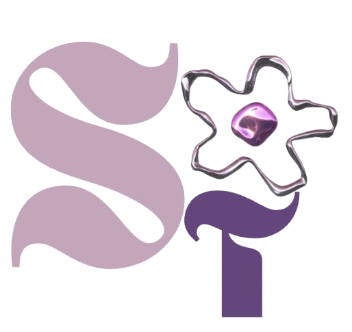

<div align="center" style="background-color:#f6f4f0; padding: 40px 0 20px;">



# Shruti Tokekar
### Developer · Designer · Creative Technologist

[](http://shrutitokekar.com)
[](https://vitejs.dev)
[](https://tailwindcss.com)
[](https://vercel.com)
[](https://github.com/ShrutiTokekar/Portfolio-site/actions/workflows/portfolio-sync.yml)

</div>

---

## About

A clean, modern, and fully responsive personal portfolio built with React + Vite — designed to showcase my work across both engineering and design. The site features a handcrafted cream aesthetic, a crash-animation hero, an interactive terminal, and dual portals for my development and design work.

The project pages keep themselves up to date. A small GitHub Actions bot watches my GitHub repos and Figma files, adds new work, and refreshes descriptions when a project changes, so the site never falls behind what I'm building.

🌐 **[shrutitokekar.com](http://shrutitokekar.com)**

---

## Features

- **Crash-animation hero** with particle effects and 3D typography
- **Live terminal component** reflecting current stack and projects
- **Dual portals** — separate spaces for design and engineering work
- **Design case studies** at `/design/:slug`, with overview, process steps, key decisions, color palette and type specimens
- **Self-updating projects** — new GitHub repos become project cards, and README changes refresh their descriptions automatically
- **Figma → case study** — new Figma designs (plus their FigJam user flows) become case studies after a one-word approval
- **Animated contact form** powered by EmailJS, no backend required
- **Smooth page transitions** and hover interactions via CSS animations
- **Fully responsive** across mobile, tablet, and desktop
- **Resume download** straight from the site

---

## Tech Stack

| Layer | Technology |
|---|---|
| Frontend | React.js + Vite |
| Styling | Tailwind CSS + inline styles |
| Routing | React Router |
| Contact Form | EmailJS |
| Content data | JSON + JS data files (`src/data/`) |
| Automation | GitHub Actions, GitHub REST API, Figma REST API |
| Image processing | sharp (Figma frames → WebP covers, heroes and steps) |
| Summaries | AI-written from READMEs and Figma screens |
| Deployment | Vercel |

---

## Project Structure

```
src/
├── assets/
│   └── case-studies/<slug>/   # cover, hero and step images per case study
├── components/
│   ├── Hero.jsx               # Crash animation, terminal, portal cards
│   ├── HomeSections.jsx       # Home page sections and case study carousel
│   ├── About.jsx              # Timeline, skills accordion, certificates
│   ├── DesignPortfolio.jsx    # /design case study grid
│   ├── CaseStudy.jsx          # /design/:slug detail page
│   ├── Projects.jsx           # /projects dev project grid
│   ├── Contact.jsx
│   ├── Terminal.jsx           # Live terminal component
│   └── Navbar.jsx · SiteNav.jsx · Footer.jsx · CoverStandIn.jsx
├── data/
│   ├── projects.json              # Dev project cards (kept in sync with GitHub)
│   ├── caseStudies.js             # Hand-written design case studies
│   ├── caseStudies.generated.json # Case studies built from Figma
│   └── about.js
├── hooks/ · utils/
├── public/resume.pdf
├── App.jsx                    # Routing and layout
└── main.jsx                   # Entry point
scripts/portfolio-sync/        # The sync bot (see its README)
.github/workflows/
└── portfolio-sync.yml         # Runs the bot hourly and on /add or /skip
vercel.json                    # SPA rewrites
```

---

## Pages

| Route | Description |
|---|---|
| `/` | Hero with crash animation and terminal |
| `/about` | Timeline, skills accordion, certificates |
| `/design` | UI/UX and web design case studies |
| `/design/:slug` | A single case study |
| `/projects` | Engineering and development projects |
| `/contact` | Contact form and links |

---

## Auto-sync

`scripts/portfolio-sync` runs on GitHub Actions every hour and commits any updates, which Vercel then deploys.

| When I… | The site… |
|---|---|
| Create a new public repo | Gets a new card on `/projects` with a summary of its README, tech stack and GitHub link |
| Update a repo's README | Refreshes that card's description and tech stack |
| Create a new Figma design | Opens a GitHub issue asking whether to add it |
| Reply `/add` (optionally with a FigJam flow link) | Gets a new case study on `/design`, with images exported from the file |
| Reply `/skip` | Leaves it off |

Cards marked `"locked": true` in `projects.json` keep their hand-written wording. Setup and options are in [`scripts/portfolio-sync/README.md`](scripts/portfolio-sync/README.md).

---

## About Me

**B.S. Computer Science, Minor in Graphic & Web Design**  
East Stroudsburg University · Allentown, PA

I build things that live at the intersection of design and engineering — from biotech marketing sites to interactive portfolios. I care about the details: the animation timing, the type scale, the way a hover feels.

📧 [shrutitokekar@gmail.com](mailto:shrutitokekar@gmail.com)  
🌐 [shrutitokekar.com](http://shrutitokekar.com)  
💻 [github.com/ShrutiTokekar](https://github.com/ShrutiTokekar)  
🔗 [linkedin.com/in/shruti-tokekar](https://linkedin.com/in/shruti-tokekar)

---

<p align="center">
  <sub>© 2026 Shruti Tokekar · All rights reserved.</sub>
</p>
